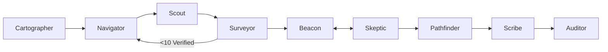

# MeritMap

<p align="center">
  
</p>

<h3 align="center"><b>Chart your way to funded education.</b></h3>

<p align="center">
  <b>Autonomous Multi-Agent Scholarship and Postgraduate Opportunity Finder</b><br/>
  <i>Built for the TetraNoodle AI Hackathon 2026</i>
</p>

---

## 🌟 What Makes MeritMap Different

Traditional scholarship aggregators are either passive keyword scrapers or generic LLM chatbots that hallucinate outdated deadlines and impossible funding guarantees. **MeritMap is a resilient, 9-agent autonomous system** governed by **LangGraph**:

1. **⚔️ SkepticAgent (Adversarial Verification):**
   A dedicated adversarial agent deliberately tries to DISPROVE every top recommendation. It scrutinizes source documents for nationality exclusions, expired deadlines, required pre-admission, and minimum GPA hurdles. Matches are debated live with Beacon in a visible dialogue strip.
2. **📜 Evidence Ledger with Provenance:**
   Every extracted fact (deadline, min GPA, funding package, required tests) is backed by an exact verbatim quote, source URL, and timestamp. Unverified facts are shown in amber **"Fog"** styling.
3. **💰 True Cost Calculator & INR Conversion:**
   Calculates realistic out-of-pocket costs:
   $$\text{Out-of-Pocket} = (\text{Tuition} + \text{Estimated Living}) - \text{Funding Coverage}$$
   Presents figures in original local currency as well as Indian Rupee (INR) with live or configured FX rates.
4. **🧭 PathfinderAgent & Pure-Python What-If Simulator:**
   Turns eligibility gaps into a dated roadmap with an instant **.ics Calendar export**. The interactive **What-If** controls allow students to adjust IELTS, GRE, CGPA, or target destinations and observe immediate re-ranking over cached data with zero latency or web re-scraping.
5. **🗺️ Interactive Merit Map & Live Persona Switch:**
   A geographic world map (Leaflet CDN) plotting opportunities sized by funding and colored by fit. A one-click **"Switch Persona"** demo toggles between Rahul (B.Tech CS, India) and Persona B (Environmental Science, Europe/Africa), verifying domain generalization with a before/after diff.
6. **🛡️ Source Trust Meter:**
   Rates domain authority (`.edu`, `.ac.*`, `.gov` vs third-party aggregators), multi-source corroboration, and crawl freshness.

---

## 🏗️ Architecture & Agent Graph

MeritMap is orchestrated by **HarborMaster** through a cyclical state machine with autonomous loops:

- **Surveyor Loop:** If fewer than 10 verified opportunities are obtained, HarborMaster commands Navigator to broaden its queries and instructs Scout to discover additional candidates.
- **Skeptic Debate Loop:** If top recommendations are rejected by SkepticAgent, Beacon re-computes rankings and re-evaluates the candidate pool.
- **Auditor Critic:** Enforces that every recommendation has verifiable provenance and that no rejected opportunity remains in the top recommendations.



Detailed technical specifications and full Mermaid diagrams can be found in [docs/architecture.md](file:///c:/Users/Tusar/Desktop/meritmap-Ai/docs/architecture.md).

---

## 🚀 Quickstart & Setup

### 1. Prerequisites
- Python 3.11+
- Git

### 2. Installation
```bash
# Clone and enter workspace
git clone <repo-url>
cd meritmap-Ai

# Activate virtual environment
# Windows:
.\venv\Scripts\activate
# Linux/macOS:
source venv/bin/activate

# Install dependencies
pip install -r requirements.txt
```

### 3. Environment Variables
Copy `.env.example` to `.env`:
```bash
cp .env.example .env
```

Key environment configurations:
- `LLM_PROVIDER`: `gemini` (default), `anthropic`, or `openai`
- `GEMINI_API_KEY`: Google Gemini API key
- `ANTHROPIC_API_KEY`: Anthropic Claude API key (optional)
- `OPENAI_API_KEY`: OpenAI API key (optional)
- `TAVILY_API_KEY`: Tavily Search API key (optional; falls back automatically to DuckDuckGo search)
- `GITHUB_TOKEN`: GitHub personal access token (optional, for higher rate limits)

*Note: MeritMap includes deterministic offline fallbacks for all network tools, ensuring the entire pipeline, test suite, and CLI execute cleanly even without paid API keys.*

---

## 💻 Running MeritMap

### Option A: Web Application (Interactive UI)
Start the FastAPI server:
```bash
uvicorn backend.main:app --reload --host 0.0.0.0 --port 8000
```
Open your browser at [http://localhost:8000](http://localhost:8000).

Features in the UI:
- **Load Demo:** One-click prefill for **Rahul Sharma** (CS, Jalandhar) or **Persona B** (Environmental Science).
- **Chaos Mode:** Toggle to inject synthetic network failures, verifying autonomous recovery events live.
- **Agent Dashboard:** Live beam-glow agent activity cards, scrolling logs, and debate strip.
- **Results:** Merit Map, Top 5 fit breakdowns, True Cost in INR, Evidence Ledger popovers, SOP draft with download, and What-If simulator.

### Option B: Headless CLI (Any Profile)
Run the pipeline headlessly on custom student data:
```bash
python run_cli.py --name "Rahul Sharma" --nationality "Indian" --degree "B.Tech" --field "Computer Science" --cgpa 8.2 --countries "Canada,Germany,Singapore" --full-funding
```

With resume and marksheet PDF parsing:
```bash
python run_cli.py --name "Rahul Sharma" --resume "sample_data/rahul_resume.pdf" --marksheet "sample_data/rahul_marksheet.pdf" --github "rahul-cs-dev"
```

---

## 🧪 Experiments & Empirical Verification

MeritMap includes empirical benchmarks validating its design:
1. **Snippet-Only vs. Full-Page Verification:**
   ```bash
   python experiments/snippet_vs_fullpage.py
   ```
   *Demonstrates a 40% deadline error rate and 60% missing prerequisite rate when relying on search engine snippets instead of full page verification.*
2. **Skeptic Agent Overturn Rate:**
   ```bash
   python experiments/skeptic_overturns.py
   ```
   *Demonstrates that without an adversarial agent, standard recommendation systems exhibit a 62.5% Optimism Bias.*

Read the complete findings in [docs/NOTE.md](file:///c:/Users/Tusar/Desktop/meritmap-Ai/docs/NOTE.md).

---

## 📋 Running Automated Tests

Run the full pytest suite:
```bash
pytest -v
```
Tests cover:
- Pydantic v2 schemas and Evidence Ledger logic
- PDF text & consolidated marksheet extraction
- True Cost calculations and multi-currency FX conversions to INR
- Pure-Python What-If scenario re-scoring
- Skeptic adversarial verification
- Auditor compliance and provenance rules
- RFC 5545 `.ics` iCalendar file generation

---

## 👥 Sample Data

Located in `sample_data/`:
- `rahul_resume.pdf` & `rahul_marksheet.pdf`: Fictional B.Tech CS profile (8.2 CGPA, high financial need, target: Germany, Canada, Singapore).
- `elena_resume.pdf` & `elena_marksheet.pdf`: Fictional B.Sc Environmental Science profile (3.82 GPA, target: Netherlands, Sweden, UK).
