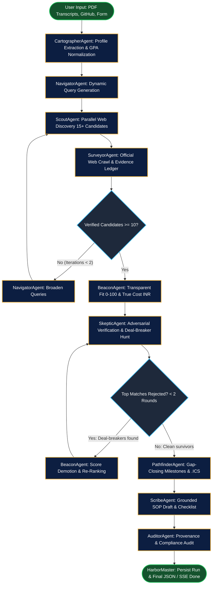

# MeritMap Architecture & Agent Graph

MeritMap is a multi-agent system designed for autonomous scholarship and funded graduate program discovery. Instead of a linear question-answering chatbot, MeritMap operates as a directed state graph orchestrated by **HarborMaster** via **LangGraph**.

---

## 1. Multi-Agent Graph Architecture

---

## 2. Core Agents and Responsibilities

| Agent | Responsibility | Core Tools & Technologies |
| :--- | :--- | :--- |
| **CartographerAgent** | Ingests PDF transcripts, resume documents, and public GitHub repositories. Normalizes GPA to standard 4.0 and 10.0 scales. Merges manual form overrides. | `pdfplumber`, `pypdf`, GitHub REST API, `llm_structured` |
| **NavigatorAgent** | Formulates 6–10 search vectors across destination countries, degree levels, and funding brackets. Implements autonomous query broadening if candidate yield is low. | Dynamic search prompt generation, domain specialization |
| **ScoutAgent** | Discovers raw scholarship opportunities in parallel. Enforces aggregator-spam filtering (rejecting low-quality scraper sites) and favors `.edu`, `.ac.*`, and `.gov` sources. | `tavily-python`, `duckduckgo-search`, regex domain filters |
| **SurveyorAgent** | Crawls official institution pages to capture verbatim quotes for the Evidence Ledger. Recursively traverses application guidelines one level deep. | `httpx`, `trafilatura`, `BeautifulSoup4`, Wayback Machine fallback |
| **BeaconAgent** | Scores candidate fit across 6 weighted dimensions (0–100 total). Computes the True Cost Calculator (tuition + living expenses − funding) and converts to INR. Evaluates Source Trust Ratings. | Deterministic scoring matrix, multi-currency FX table, provenance rating |
| **SkepticAgent** | Adversarially tests top matches. Hunts for disqualifying clauses (e.g. nationality restrictions, expired deadlines, required pre-admission, unmet GPA cutoffs). Conducts live debate with Beacon. | Adversarial verification engine, regex date & eligibility checkers |
| **PathfinderAgent** | Translates eligibility gaps into a dated roadmap. Exports all milestones to an iCalendar (`.ics`) file. Powers instant pure-Python What-If scenario simulations. | Pure-Python re-scoring, iCalendar RFC 5545 generator |
| **ScribeAgent** | Drafts an academic Statement of Purpose strictly grounded in student profile credentials. Inserts explicit placeholders for missing specifics and builds document checklists. | Grounded LLM generation, document checklist generator |
| **AuditorAgent** | Acts as final quality inspector. Verifies that every recommendation possesses an official URL and evidence quote, and checks that no Skeptic-rejected opportunity remains in the Top 3. | Pydantic rule validator, provenance inspector |
| **HarborMaster** | Central LangGraph supervisor coordinating state transitions, conditional candidate replenishment loops, debate iterations, and event stream persistence. | `LangGraph` StateGraph, SSE Event Bus (`sse-starlette`) |

---

## 3. Resilience and Failure Recovery

MeritMap embeds autonomous failure recovery across each tier:
1. **Network & Crawl Failure:** 2-step exponential backoff retry followed by Wayback Machine archive lookup, or graceful fallback to search engine snippet provenance with an explicit amber "Fog" badge.
2. **LLM Structured Extraction Failure:** Pydantic validation catches JSON schema drift and re-prompts the model with the exact validation error (up to 2 retries).
3. **Candidate Scarcity Loop:** If fewer than 10 verified opportunities exist, Navigator broadens queries with relaxed geographic and institutional filters, rerunning Scout and Surveyor.
4. **Chaos Mode:** Deliberately simulates network dropouts and corrupted outputs to demonstrate automated recovery live in the UI.
